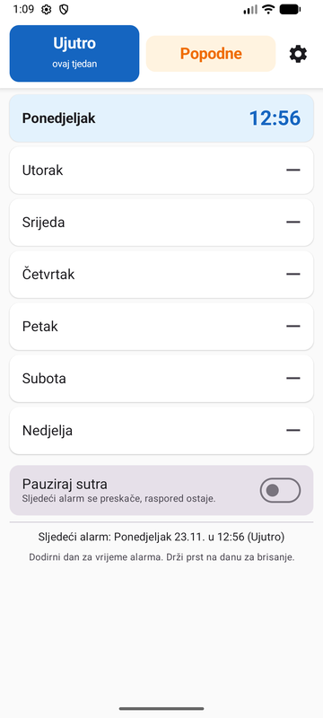
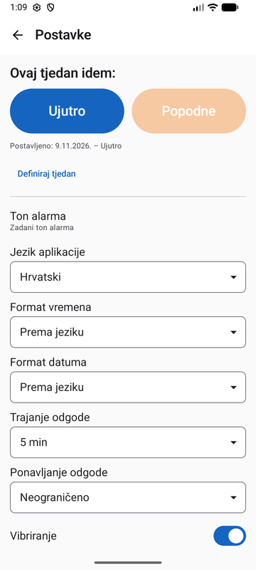

<p align="center">
  
</p>

<h1 align="center">AB Alarm</h1>

<p align="center">
  Budilica za dvosmjensku nastavu: alarmi za tjedan <b>ujutro</b> i tjedan <b>popodne</b> izmjenjuju se automatski.<br>
  <i>An alarm clock for two-shift schooling: <b>morning</b> and <b>afternoon</b> week alarms alternate automatically.</i>
</p>

<p align="center">
  <a href="#hrvatski">Hrvatski</a> · <a href="#english">English</a>
</p>

<p align="center">
  
  &nbsp;&nbsp;
  
</p>

---

<a id="hrvatski"></a>
## 🇭🇷 Hrvatski

### Čemu služi

U hrvatskim školama učenici jedan tjedan idu u školu ujutro, a sljedeći popodne. Roditelji i djeca zato svaki tjedan ručno prebacuju alarme, a pritom je lako pogriješiti.

**AB Alarm** omogućuje da jednom postaviš alarme za oba tjedna, a aplikacija ih zatim sama izmjenjuje.

### Značajke

- **Dvije smjene, 14 alarma:** svaki dan u tjednu „Ujutro” i tjednu „Popodne” ima svoj alarm ili je isključen. Vikend se postavlja zasebno.
- **Jednostavno sučelje:** dodir na dan postavlja vrijeme, a dugi pritisak briše alarm.
- **Dodatni alarmi za aktivnosti:** strelica desno uz dan otvara popis dodatnih alarma (trening, strani jezik, glazbena…), do 5 po danu i zasebno za svaku smjenu. Mogu biti i jutarnji, npr. engleski u tjednu kad je škola popodne. Kad je dan sklopljen, njihova vremena pišu se sitno ispod naziva dana. „Pauziraj sutra” ih ne preskače.
- **Automatska izmjena smjena:** dovoljno je jednom reći „ovaj tjedan idem ujutro”. Taj dan ne mora biti ponedjeljak.
- **Pauziraj sutra:** preskače sljedeći alarm, a raspored ostaje nepromijenjen.
- **Pouzdano zvoni:** koristi `setAlarmClock()`, pa zvoni na vrijeme i kad je mobitel u stanju mirovanja (Doze). Nakon restarta mobitela alarmi se ponovno zakazuju.
- **Odgoda:** trajanje od 5 do 30 min i najveći broj odgoda (1, 3, 5, 10 ili neograničeno).
- **Prikaz preko zaključanog zaslona** s velikim gumbima „Odgodi” i „Zaustavi”.
- **Jezik i formati:** hrvatski ili engleski, neovisno o jeziku sustava. Format vremena (12/24 h) i datuma bira se zasebno.
- **Čarobnjak za dopuštenja**, s uputama za Xiaomi, Huawei, OPPO i vivo.

### Instalacija

1. Preuzmi najnoviji `AB-Alarm-vX.Y.apk` s [Releases](../../releases/latest).
2. Otvori datoteku na mobitelu i dopusti instalaciju iz nepoznatih izvora.
3. Pri prvom pokretanju dopusti obavijesti, pa odaberi ideš li ovaj tjedan ujutro ili popodne.
4. Otvori **Postavke → Provjeri dopuštenja** i prođi kroz korake.

Potreban je **Android 8.0 (API 26)** ili noviji.

> ℹ️ AB Alarm je u ranoj fazi razvoja (0.x). APK je potpisan release ključem, pa se nove verzije instaliraju preko starih bez gubitka postavki.

### Kako se računa tjedan

Interno se smjene zovu Tjedan A (ujutro) i Tjedan B (popodne). Korisnik odabere jedan datum (bilo koji dan u tjednu) i kaže koja je smjena u tom tjednu. Za svaki drugi datum aplikacija:

1. svede oba datuma na **ponedjeljak** njihova tjedna,
2. izračuna razliku u tjednima: `Math.floorDiv(razlikaDana, 7)`,
3. ako je razlika paran broj, to je isti tjedan; ako je neparan, to je drugi tjedan.

Zato radi i kad je zadani datum u srijedu ili nedjelju, za datume prije zadanog datuma te preko granice mjeseca, godine i prijestupne godine. Sve je pokriveno unit testovima.

### Izgradnja iz izvornog koda

Potrebni su Android Studio (ili JDK 17+) i Android SDK.

```bash
./gradlew assembleDebug          # APK: app/build/outputs/apk/debug/app-debug.apk
./gradlew testDebugUnitTest      # unit testovi (izračun tjedna, sljedeći alarm, odgoda)
./gradlew installDebug           # instalacija na spojeni mobitel/emulator
```

**Potpisani release APK:** u korijenu projekta napravi datoteku `keystore.properties` (ne ide u git):

```properties
storeFile=C:/putanja/do/kljuca.jks
storePassword=...
keyAlias=...
keyPassword=...
```

zatim pokreni `./gradlew assembleRelease`. APK će biti u `app/build/outputs/apk/release/app-release.apk`. Bez te datoteke release build se izgradi, ali nepotpisan.

**Ručno testiranje izmjene tjedana:** u **Postavke → Definiraj tjedan** odaberi datum iz prošlog tjedna s istom oznakom. Oznaka „ovaj tjedan” i redak „Sljedeći alarm” trebaju se prebaciti na drugi tjedan.

**Provjera zakazanog alarma:** `adb shell dumpsys alarm | grep hr.abalarm`

### Struktura projekta

```
app/src/main/java/hr/abalarm/app/
├── data/          modeli, DataStore repozitorij
├── domain/        izračun tjedna i sljedećeg alarma (čisti Kotlin, testirano)
├── alarm/         AlarmManager (setAlarmClock), receiveri, ForegroundService, obavijesti
├── permissions/   provjere dopuštenja, upute po proizvođaču
├── ui/            Compose ekrani (glavni, postavke, dopuštenja, alarm), tema, jezik
└── MainActivity.kt
```

Tehnologije: Kotlin, Jetpack Compose (Material 3), MVVM (ViewModel + StateFlow), DataStore, Navigation Compose i AlarmManager.

### Poznata ograničenja

- Neki proizvođači (Xiaomi, Huawei, OPPO, vivo…) agresivno gase aplikacije u pozadini. Upute u aplikaciji pomažu, ali nazivi izbornika razlikuju se po verziji sustava.
- Odgoda koja je u tijeku ne preživi restart mobitela. Redovni alarmi se nakon restarta ponovno zakazuju.

---

<a id="english"></a>
## 🇬🇧 English

### What it is for

In Croatian schools, students attend school in the morning one week and in the afternoon the next. Parents and children have to switch their alarms by hand every week, which makes mistakes easy.

**AB Alarm** lets you set alarms for both weeks once, and the app alternates them on its own.

### Features

- **Two shifts, 14 alarms:** every day in the "Morning" week and the "Afternoon" week has its own alarm or is turned off. Weekends are set separately.
- **Simple interface:** tap a day to set the time, press and hold to delete the alarm.
- **Extra alarms for activities:** the arrow on the right of a day opens a list of extra alarms (training, language class, music school…), up to 5 per day and separate for each shift. They can also be in the morning, e.g. an English class in the week when school is in the afternoon. When the day is collapsed, their times are shown in small text under the day name. "Pause tomorrow" does not skip them.
- **Automatic shift switching:** just say "this week I go in the morning" once. That day does not have to be a Monday.
- **Pause tomorrow:** skips the next alarm and leaves the schedule unchanged.
- **Reliable ringing:** uses `setAlarmClock()`, so it rings on time even when the phone is idle (Doze). Alarms are rescheduled after the phone restarts.
- **Snooze:** length from 5 to 30 min and a maximum number of snoozes (1, 3, 5, 10 or unlimited).
- **Full screen over the lock screen**, with big "Snooze" and "Stop" buttons.
- **Language and formats:** Croatian or English, independent of the system language. Time format (12/24 h) and date format are chosen separately.
- **Permissions wizard**, with instructions for Xiaomi, Huawei, OPPO and vivo.

### Installation

1. Download the latest `AB-Alarm-vX.Y.apk` from [Releases](../../releases/latest).
2. Open the file on your phone and allow installing from unknown sources.
3. On first launch, allow notifications, then choose whether you go to school in the morning or the afternoon this week.
4. Open **Settings → Check permissions** and go through the steps.

Requires **Android 8.0 (API 26)** or newer.

> ℹ️ AB Alarm is in early development (0.x). The APK is signed with a release key, so new versions install over old ones without losing your settings.

### How the week is calculated

Internally, the shifts are called Week A (morning) and Week B (afternoon). The user picks one date (any day of the week) and says which shift that week is. For every other date, the app:

1. moves both dates back to the **Monday** of their week,
2. calculates the difference in weeks: `Math.floorDiv(dayDifference, 7)`,
3. if the difference is even, it is the same week; if it is odd, it is the other week.

This means it works when the chosen date is a Wednesday or a Sunday, for dates before the chosen date, and across month, year and leap-year boundaries. All of this is covered by unit tests.

### Building from source

You need Android Studio (or JDK 17+) and the Android SDK.

```bash
./gradlew assembleDebug          # APK: app/build/outputs/apk/debug/app-debug.apk
./gradlew testDebugUnitTest      # unit tests (week calculation, next alarm, snooze)
./gradlew installDebug           # install on a connected phone/emulator
```

**Signed release APK:** create a `keystore.properties` file in the project root (it is not committed to git):

```properties
storeFile=C:/path/to/key.jks
storePassword=...
keyAlias=...
keyPassword=...
```

then run `./gradlew assembleRelease`. The APK will be in `app/build/outputs/apk/release/app-release.apk`. Without that file the release build still works, but the APK is unsigned.

**Testing week switching by hand:** in **Settings → Define week**, pick a date from last week with the same label. The "this week" label and the "Next alarm" line should switch to the other week.

**Checking the scheduled alarm:** `adb shell dumpsys alarm | grep hr.abalarm`

### Project structure

```
app/src/main/java/hr/abalarm/app/
├── data/          models, DataStore repository
├── domain/        week and next-alarm calculation (plain Kotlin, tested)
├── alarm/         AlarmManager (setAlarmClock), receivers, ForegroundService, notifications
├── permissions/   permission checks, manufacturer-specific instructions
├── ui/            Compose screens (main, settings, permissions, alarm), theme, language
└── MainActivity.kt
```

Built with Kotlin, Jetpack Compose (Material 3), MVVM (ViewModel + StateFlow), DataStore, Navigation Compose and AlarmManager.

### Known limitations

- Some manufacturers (Xiaomi, Huawei, OPPO, vivo…) aggressively stop apps in the background. The in-app instructions help, but menu names differ between system versions.
- A snooze that is in progress does not survive a phone restart. Regular alarms are rescheduled after a restart.
